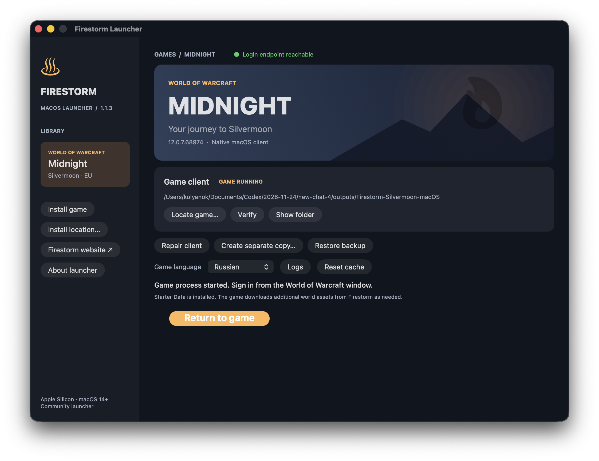

# Firestorm macOS Launcher

An independent native launcher for **Firestorm Midnight / Silvermoon**, targeting **World of Warcraft 12.0.7.68974** on **Intel and Apple Silicon** and **macOS 14 or later**.

> [!IMPORTANT]
> After extracting the ZIP, drag **Firestorm Launcher.app** to **Applications** in Finder, then open it from there.
> Keep `World of Warcraft.app` inside `_midnight_` in your game folder so WoW can find its `Data` folder.
>
> Version **1.1.7** fixes `../Data: Read-only file system` after downloading the launcher. Quit WoW and the older launcher, replace **Firestorm Launcher.app**, and click **Play** for your existing installation.

This repository contains launcher and compatibility-patch source code, build metadata, and development checks. It does **not** contain the World of Warcraft application, game Data, compiled patch libraries, or release archives. The full binary release is a separate download and includes the prepared macOS game application and compatibility patch.

## Download

**[Download Firestorm Launcher 1.1.7 for Intel & Apple Silicon](https://github.com/kolyanok/firestorm-macos-launcher/releases/download/v1.1.7/Firestorm-Launcher-1.1.7-macOS-Universal.zip)**

One **Universal 2** package contains the launcher and prepared game client for **Intel (`x86_64`) and Apple Silicon (`arm64`)**. Requires macOS 14 or later.

The macOS ZIP is also available under **Assets** on the [release page](https://github.com/kolyanok/firestorm-macos-launcher/releases/tag/v1.1.7).

## Screenshot



## Features

- Universal 2 support for Intel and Apple Silicon, including their matching game compatibility patches.
- Launches WoW from its installation directory so it can locate the adjacent game data after a browser download.
- Native macOS interface in English, with configurable game text and voice language.
- Starter Data downloads from Firestorm with pause and resume support.
- Installation into a new folder or selection of an existing compatible client.
- Independent APFS cloning of existing game Data on the same volume.
- Client verification, application backups, restoration, and legacy starter-index repair.
- A first-launch notice explaining that startup can take around ten minutes while more data downloads.
- Logs and cache reset controls. Account credentials are entered only in the game.

The launcher is pinned to build **12.0.7.68974**. It does not automatically upgrade to newer game builds.

## Install and play

1. Download the full macOS launcher archive from the [**Releases** page](https://github.com/kolyanok/firestorm-macos-launcher/releases/latest) and extract it.
2. In Finder, drag **Firestorm Launcher.app** to **Applications**, then open it from there.
3. Choose a game language and click **Install**. The default location is `~/Games/Firestorm Midnight`; use **Install location…** to change it.
4. When installation finishes, click **Play** and sign in from the game window.

The full binary release includes the macOS game application. Installation downloads approximately **297 MB** of starter Data, then the game streams additional world assets from Firestorm as needed. This is a streaming installation, not a preload of all game content. Allow at least **3 GB** free for installation staging, plus space for further game downloads.

**Cold first launch:** with only starter Data installed, the first start can take around **ten minutes** before a window appears. The WoW icon may keep bouncing in the Dock during this time. Keep the game open and wait; slower connections may take longer. This is an estimate, not a timeout.

**Pause** saves downloaded parts. Use **Resume install** or **Install game** with the same destination and language to continue.

If macOS blocks the initial opening, use **System Settings → Privacy & Security → Open Anyway**. The current release is ad hoc signed and is not notarized by Apple.

## Existing installations and repair

Use **Locate game…** to select a client folder containing `.fsbuild`, `Data`, and `_midnight_`, or the `World of Warcraft.app` inside it. The game build must match **12.0.7.68974**.

**Repair client** repairs older launcher-generated starter indices when necessary, prepares the bundled game application, and updates the Firestorm connection profile. It preserves Data archive contents. **Restore backup** restores the previously saved application and `WTF/Firestorm.wtf` settings. Close World of Warcraft before either operation.

**Create separate copy…** uses APFS clones on the same volume. It does not copy account data, saved logins, add-ons, cache, or logs from the source installation.

**Verify** checks the game application against the payload manifest and validates the installation structure. It does not scan all world-data archives. A reachable login endpoint does not guarantee that the game realm is available or that an account login will succeed.

If an older version shows `CASInitialize() failed to create folder ../Data: Read-only file system`, update the launcher to 1.1.7 or later and click **Play**. The corrected launcher starts the existing client executable from `_midnight_`. Launch diagnostics are written to `_midnight_/Logs/GameLaunch.log`.

## Build from source

Build requirements:

- macOS with Command Line Tools providing Swift.
- A local payload directory containing the matching `Client.zip` and `client-manifest.json`.

The client payload is intentionally absent from Git. The JSON in `Resources/client-manifest.json` contains only file names and checksums. The existing installer expects a prepared payload; removing that requirement would require additional implementation.

If a full release archive has been extracted, the payload is under `Firestorm Launcher.app/Contents/Resources`. Point the build script to that local directory:

```sh
FIRESTORM_CLIENT_PAYLOAD_DIR="/path/to/Firestorm Launcher.app/Contents/Resources" bash build.sh
```

Alternatively, place both payload files in the local `Resources` directory. `Client.zip` remains ignored by Git. A sibling `Firestorm Launcher.app/Contents/Resources` is also recognized when no payload directory is specified.

The default output directory is `dist` inside this repository. To choose another location:

```sh
FIRESTORM_CLIENT_PAYLOAD_DIR="/path/to/payload" bash build.sh "/path/to/output"
```

Outputs are `Firestorm-Launcher/Firestorm Launcher.app` and `Firestorm-Launcher-macOS.zip`. Building compiles both launcher architectures, combines them into a Universal 2 executable, signs the launcher, packages the local payload, and includes the source files in the release archive. The payload must already include the matching client libraries for both architectures. It does not launch the game or run the development checks.

`test.sh` contains optional development checks for the installation core. Run it manually only when desired; the build script does not invoke it.

The checks default to the host architecture. Use `FIRESTORM_TEST_ARCH=x86_64 bash test.sh` to run the Intel checks on an Intel Mac or through Rosetta on Apple Silicon.

## Compatibility patch

The supplied patch changes certificate-trust checks inside the prepared game process for Firestorm compatibility. It does not change the macOS system certificate store. Use a separate game copy for this server. Patch sources and signing entitlements are in `ProvidedPatch`.

The prepared game loads the supplied `libFirestormCertBypassX86.dylib` on Intel. The Intel patch source and installation scripts are under `ProvidedPatch/x86_64`. The Apple Silicon client loads its existing ARM libraries. macOS selects the executable architecture automatically.

## Project status and licensing

Game startup and server login have been reported working on Apple Silicon. The installation core passed 61 checks on each architecture, with Intel checks running through Rosetta. Preparation, file verification, backup restoration and launch-directory handling also passed through the Intel launcher under Rosetta. The Intel game client reached its login screen under Rosetta. Actual game startup and Silvermoon login on physical Intel hardware still require manual verification.

The original project source code and documentation are licensed under **WTFPL version 2**; see [LICENSE](LICENSE). Third-party portions retain their existing license terms and notices, including the CascLib MIT notice; see [THIRD_PARTY_NOTICES.md](THIRD_PARTY_NOTICES.md). The WTFPL grant does not cover Blizzard's game application, game Data, trademarks, or other third-party materials, including those in binary releases.

This is an unofficial community project. It is not affiliated with or endorsed by Blizzard Entertainment or the Firestorm administration. World of Warcraft and associated names and assets belong to their respective owners.
